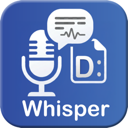
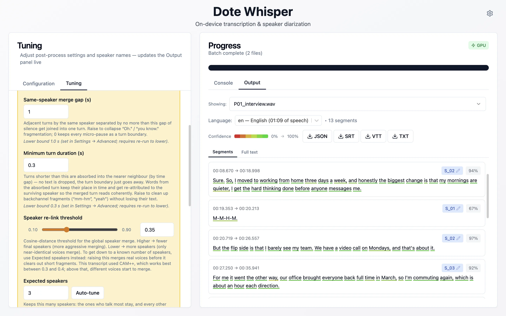

    

<h1 align="center">DOTE Whisper</h1>

    Private transcripts, speaker by speaker. 
    Free for macOS and Windows. No account, no upload.

    
    
    

    <a href="https://dote-whisper.alexstein.ca/download/"><b>Download</b></a>
    ·
    <a href="https://dote-whisper.alexstein.ca">Website</a>
    ·
    <a href="https://dote-whisper.alexstein.ca/guide/">Guide</a>
    ·
    <a href="https://dote-whisper.alexstein.ca/feedback/">Feedback</a>

## What it does

DOTE Whisper turns recorded interviews, focus groups, meetings, lectures and fieldwork into time-stamped, speaker-labelled transcripts. Speech recognition and speaker separation run on your own computer, so the recordings never leave it. You get a first draft split into speaker turns, ready to check, correct and build on.

It's made for researchers whose recordings can't go to a cloud service because of what participants consented to, an ethics approval or data-protection rules. It works just as well for anyone else with hours of audio to get through.

-   **Nothing leaves your computer.** No upload, no account, no API key and no per-minute fees. Once a model has downloaded, transcription works offline.
-   **Who said what.** Speaker diarization splits the recording into turns and labels each voice (`S_01`, `S_02`, …). Tell the app how many people took part, or let it decide, then give the voices names or pseudonyms for your exports.
-   **Tune speaker turns live.** Too many speakers, or turns chopped into fragments? Adjust a few controls and the transcript updates at once, without transcribing again.
-   **Every word timed and scored.** Each word has its own start time, end time and confidence score. Colour coding shows which passages are worth listening to again.
-   **99 languages, plus specialist models.** Whisper models from fast to most accurate. Conversations that switch language are transcribed turn by turn. Add community models from HuggingFace trained for a language or field, such as Swedish, Danish, Cantonese or medical speech.
-   **Batches and open exports.** Queue a whole project's recordings and each transcript is saved beside its file. Export JSON for [DOTE](https://www.dote.aau.dk/what-is-dote) or your own scripts, SRT and WebVTT subtitles, or plain text.

It opens MP3, WAV, FLAC, M4A, OGG, AAC and WMA audio, and the sound from MP4, MOV, MKV and AVI video. It uses the GPU on Apple silicon Macs and on Windows PCs with an NVIDIA graphics card, and the processor everywhere else.

### Know what you're getting

Automatic transcription gives you a strong first draft, not a finished transcript. Whisper tends to tidy speech up, so false starts, fillers and overlapping talk are often shortened or left out. Separating voices automatically is still hard: short backchannels, similar voices and noisy rooms cause mistakes, though the tuning controls fix most of them. Low-confidence words are marked so you know where to listen first.

## Download

Get the installer from the [latest release](https://github.com/LiminalSpaces/dote-whisper-dist/releases/latest), or use the [download page](https://dote-whisper.alexstein.ca/download/), which picks the right one for your computer.

| Computer                       | File   | Notes                                                                                               |
| ------------------------------ | ------ | --------------------------------------------------------------------------------------------------- |
| macOS, Apple silicon and Intel | `.dmg` | Open it and drag DOTE Whisper into Applications. No administrator rights needed.                    |
|                                | `.pkg` | Step-by-step installer for IT deployment with Jamf, Kandji or another MDM tool. Needs admin rights. |
| Windows 10 or 11, 64-bit       | `.exe` | Installs for your user account and adds a Start-menu shortcut. No administrator rights needed.      |
|                                | `.msi` | Installs for every user. For IT deployment with Group Policy or Intune. Needs admin rights.         |

One Mac download covers both kinds of Mac. Apple silicon (M1 or later) uses the graphics chip and is much faster; Intel Macs work, but long recordings take noticeably longer. There is no Linux version.

The `.nupkg` and `RELEASES` files in each release are for the Windows updater. You don't need to download them.

On a university or institution-managed computer, the `.dmg` and `.exe` usually install without help. If your computer won't let you install apps, ask IT to install the `.pkg` or `.msi`.

### What your computer needs

At least 8 GB of memory, and 16 GB for the Large models with long recordings. Leave a few gigabytes of disk space free for models. Smaller models run comfortably on older laptops.

### First launch

The installer holds the app itself. Each speech recognition model downloads once, the first time you pick it: from about 140 MB for Base to about 3 GB for Large V3, the default. Speaker labelling adds about 35 MB the first time you turn it on. After that, everything works offline.

The Windows installer isn't code-signed yet, so Windows may say "Windows protected your PC". Click **More info**, then **Run anyway**. The Mac version is signed and notarized by Apple.

## How to use it

The [guide](https://dote-whisper.alexstein.ca/guide/) walks through adding recordings, choosing a model and language, turning on speaker labels, tuning speaker turns and exporting, with screenshots of each step. The short version:

1. **Add your recordings.** Drop audio or video files onto the window, one file or a whole folder.
2. **Pick a model and language.** Choose between speed and accuracy, tell the app which languages are spoken or let it detect them, and turn on speaker labels.
3. **Transcribe.** The app works out who speaks when, then transcribes each turn with OpenAI's Whisper.
4. **Tune and export.** Adjust how turns and speakers are split, name the speakers, then save for DOTE, as subtitles, as plain text or as JSON.

## About this repository

This repository holds the release builds and the public issue tracker. The source code is kept in a separate, private repository. The app checks this repository's latest release to tell you when a newer version is out. It never downloads or installs anything by itself.

## Reporting a problem

In the app, choose **Help ▸ Send Feedback…**, or click **Report…** beside a failed transcription. It adds the app version and system details for you, and lets you see everything it will send first. Without the app, use the [feedback page](https://dote-whisper.alexstein.ca/feedback/). Both go to the developer privately, and neither needs a GitHub account.

To discuss something in public instead, [open an issue](https://github.com/LiminalSpaces/dote-whisper-dist/issues/new/choose). Include your operating system, the app version, the model you used and the steps that caused the problem. Issues here are public, so please don't attach recordings or transcripts you aren't allowed to share.

## Citing DOTE Whisper

If you use DOTE Whisper in published work, GitHub's **Cite this repository** button (in the sidebar) gives a citation in APA or BibTeX, taken from [CITATION.cff](CITATION.cff). Please also cite the projects it builds on:

-   OpenAI Whisper: Radford et al., 2022, [_Robust Speech Recognition via Large-Scale Weak Supervision_](https://arxiv.org/abs/2212.04356).
-   [whisper.cpp](https://github.com/ggml-org/whisper.cpp), by Georgi Gerganov.
-   [sherpa-onnx](https://github.com/k2-fsa/sherpa-onnx), by the k2-fsa project.

## Privacy and license

The app processes your recordings on your own computer and never uploads them. It has no accounts, analytics or tracking. It only goes online to download the models you choose, to check for a newer version and, if you ask it to, to send feedback. The full text is in [PRIVACY_AND_TERMS.md](PRIVACY_AND_TERMS.md).

DOTE Whisper is free under the MIT License, for personal, academic, commercial and institutional use. The open-source projects it is built on keep their own licenses: [whisper.cpp](https://github.com/ggml-org/whisper.cpp) (MIT), [sherpa-onnx](https://github.com/k2-fsa/sherpa-onnx) (Apache 2.0) and [ffmpeg](https://ffmpeg.org/legal.html) (LGPL/GPL). Each model you download keeps its own license too.
